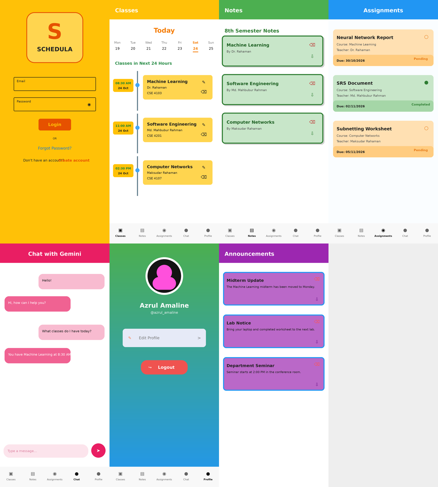
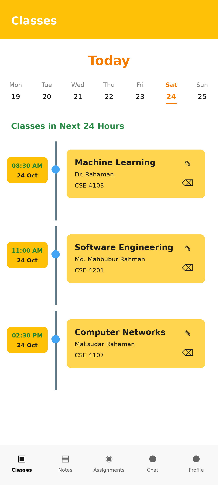
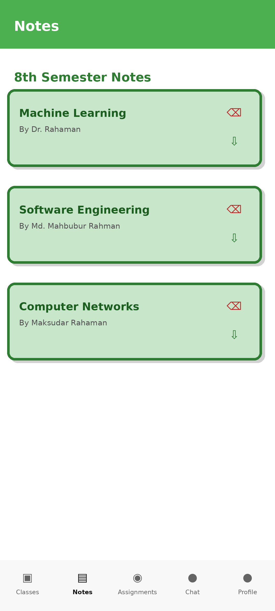
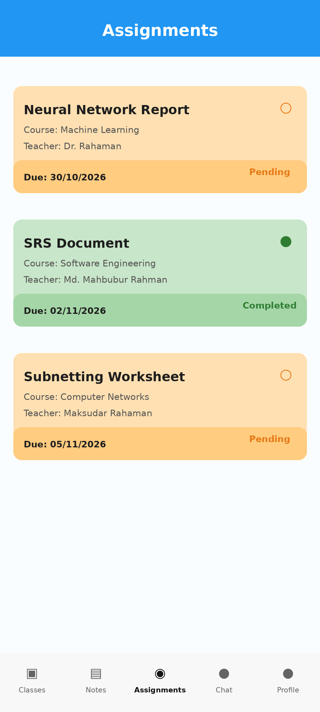
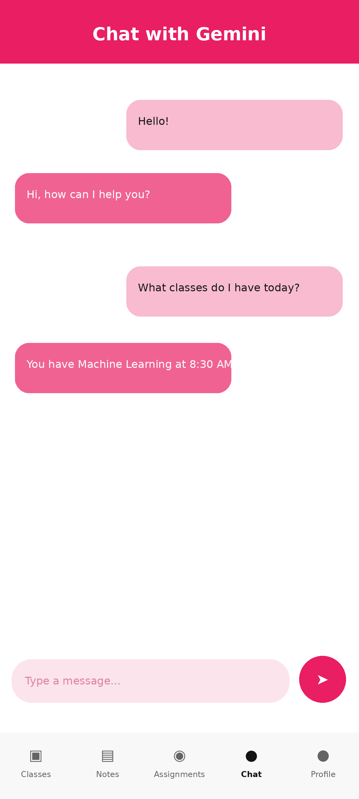
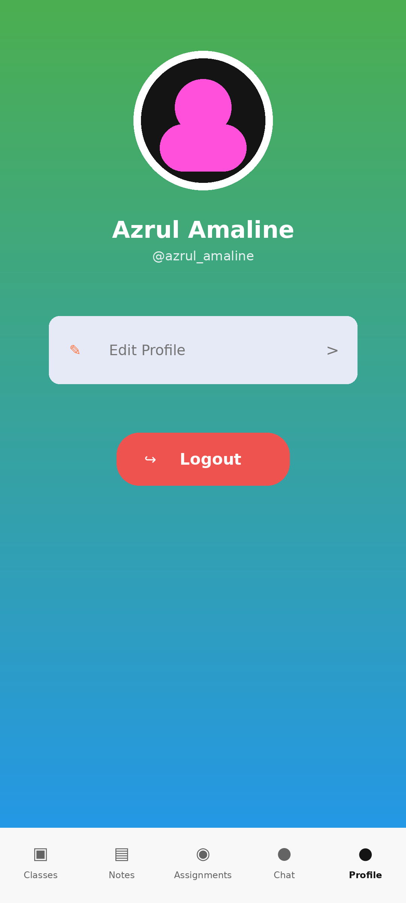
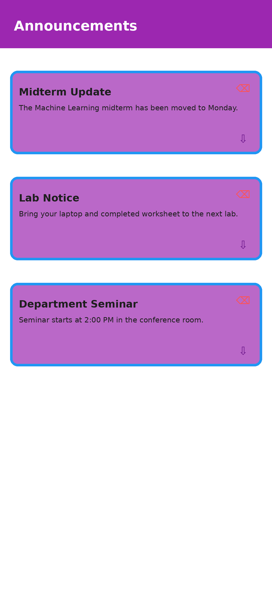
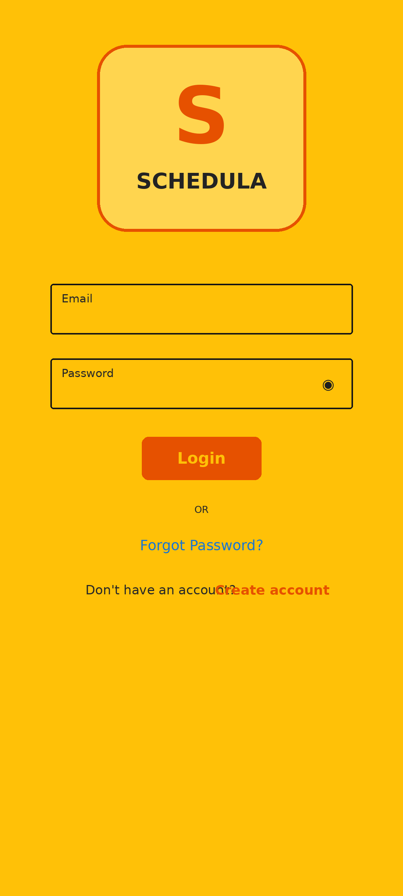

# Schedula

Your academic day, in one place.

Schedula is a Flutter app for organizing class schedules, course notes, assignments, and announcements. Students can manage coursework and profiles and chat with a Gemini-powered assistant. Administrators can manage semester content and student records.

[UI showcase](#ui-showcase) · [Features](#features) · [Getting started](#getting-started) · [Download APK](#download-apk) · [Contributing](#contributing)

## UI showcase

These mockups showcase the main screens using sample content. They are design previews; the running app may differ.



### Plan your coursework

| Classes | Notes | Assignments |
| :---: | :---: | :---: |
|  |  |  |
| Follow your class schedule. | Keep course materials together. | Track deadlines and progress. |

### Stay connected

| Gemini chat | Profile | Announcements |
| :---: | :---: | :---: |
|  |  |  |
| Ask the AI assistant questions. | Manage your student profile. | Read academic updates. |

### Account access



Browse the original images in [mockups/](mockups/).

## Features

- **Class schedules:** View upcoming classes and create or update class entries.
- **Course notes:** Organize semester notes, upload files, and download study materials.
- **Assignments:** View coursework details, due dates, and completion status.
- **Announcements:** Publish and read academic notices with attachment support.
- **AI chat:** Send questions to a Gemini-powered chat interface.
- **Student accounts:** Register, sign in, recover passwords, and edit profile details.
- **Classmates:** View fellow students and profile information.
- **Administration:** Manage semesters, students, classes, notes, and assignments.
- **Notifications:** Firebase Cloud Messaging integration with notification permission handling.

## Built with

| Area | Technology |
| --- | --- |
| App | Flutter and Dart |
| Backend | Firebase Authentication, Cloud Firestore, and Cloud Storage |
| Notifications | Firebase Cloud Messaging and Flutter Local Notifications |
| AI assistant | Gemini API over HTTP |
| State management | Provider and GetX |
| Files and documents | File Picker, Dio, and cached PDF viewing |

## Getting started

### Requirements

- Flutter SDK with Dart `>=3.3.0 <4.0.0`, as specified in [pubspec.yaml](schedula/pubspec.yaml).
- Android development tools and an emulator or physical Android device.
- A Firebase project configured for Authentication, Cloud Firestore, Cloud Storage, and Cloud Messaging.
- A Gemini API key for AI chat.

### 1. Install dependencies

```bash
git clone https://github.com/Azrul16/schedula.git
cd schedula/schedula
flutter pub get
```

The Flutter project lives in the repository's `schedula/` directory. Run all Flutter commands from that directory.

### 2. Configure Firebase

Firebase configuration and credentials are excluded from version control. Register your app with your own Firebase project and generate `lib/firebase_options.dart` using the FlutterFire CLI (install and authenticate the Firebase and FlutterFire CLIs first):

```bash
flutterfire configure
```

Update the platform configuration files as needed, including `android/app/google-services.json` for Android. Enable email/password sign-in in Firebase Authentication and configure Firestore and Storage access rules for your deployment.

### 3. Configure Gemini

Copy `.env.example` to `.env` next to `pubspec.yaml`, then supply your own key (the path from the repository root is `schedula/.env`):

```dotenv
GEMINI_API_KEY=your_gemini_api_key
```

The app loads this file at startup, and it is declared as a Flutter asset. Use your own key and avoid committing credentials. Values bundled as app assets are accessible to app users.

### 4. Run the app

```bash
flutter devices
flutter run
```

To build an Android release APK:

```bash
flutter build apk --release
```

The output is `build/app/outputs/flutter-apk/app-release.apk` inside the Flutter project.

## Download APK

[Download Schedula for Android](https://drive.google.com/file/d/1C4987gEa7M2iuzpTrDrnCc4xmXWz2wkB/view?usp=sharing)

## Project structure

| Path | Contents |
| --- | --- |
| `mockups/` | UI showcase images |
| `schedula/` | Flutter project and platform configuration |
| `schedula/lib/adminScreen/` | Semester and student administration |
| `schedula/lib/announsmentScreen/` | Academic announcements |
| `schedula/lib/assignments/` | Coursework and deadlines |
| `schedula/lib/chatAI/` | Gemini chat |
| `schedula/lib/classScreen/` | Class schedules |
| `schedula/lib/noteScreen/` | Notes and attachments |
| `schedula/lib/profile/` | Profiles and classmates |
| `schedula/lib/userAccounts/` | Registration and authentication |
| `schedula/lib/utils/` | Shared helpers |
| `schedula/lib/main.dart` | App initialization |

## Contributing

Fork the repository, create a branch, and keep changes focused. Follow the existing Dart style and describe the behavior you changed in your pull request. Include screenshots for UI changes.

From `schedula/`, format your changes and run static analysis:

```bash
dart format lib
flutter analyze
```

Add or update relevant tests when changing behavior. The existing `test/widget_test.dart` is a starter counter test and needs updating before it can validate Schedula's app flow.

## Author

[Azrul Amaline](https://github.com/Azrul16) · [azrul.amaline16@gmail.com](mailto:azrul.amaline16@gmail.com)
